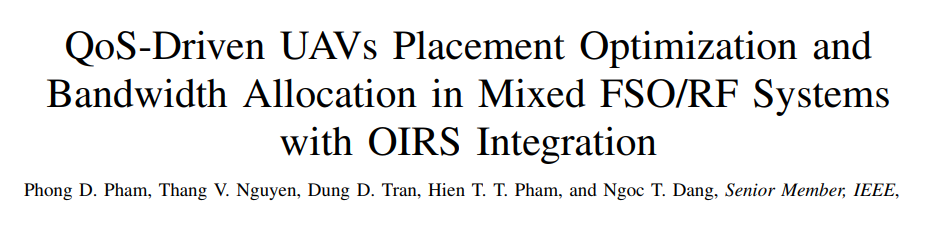
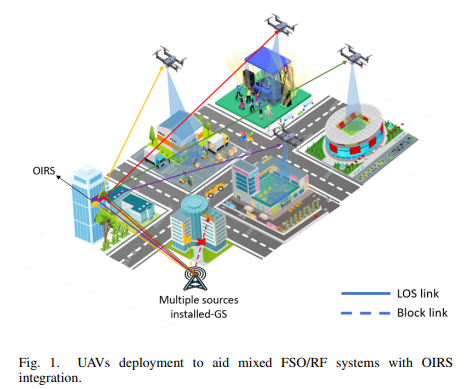
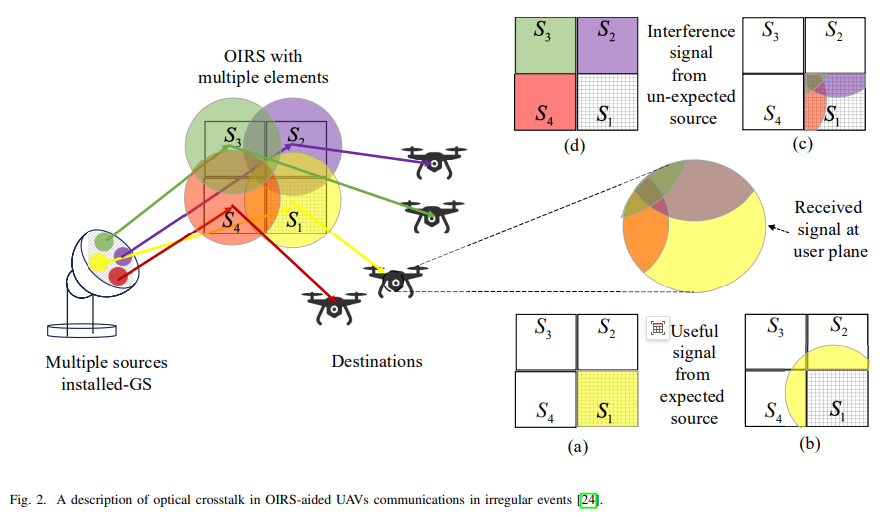
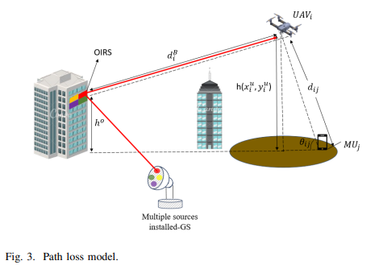
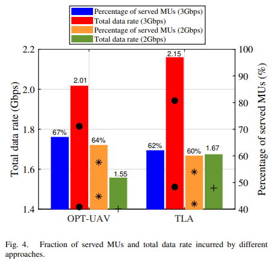
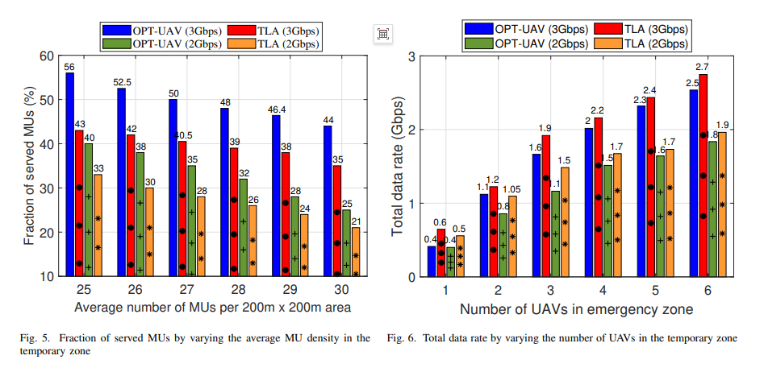
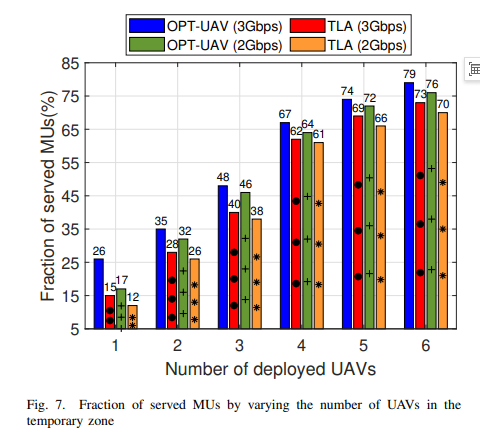

# OIRS Empowers FSO/RF Mixed System: A New Scheme for QoS Optimization of UAV Deployment and Bandwidth Allocation [with MATLAB Code]

OIRS Empowers FSO/RF Mixed Systems: A New Scheme for Optimizing QoS in Drone Deployment and Bandwidth Allocation
Title: OIRS Empowers FSO/RF Mixed Systems: A New Scheme for Optimizing QoS in Drone Deployment and Bandwidth Allocation
Abstract: This paper focuses on the issue of ensuring high-capacity, reliable wireless connectivity in temporary or disaster-affected urban environments through research on position optimization and bandwidth allocation for drones based on QoS. It introduces an integrated optical intelligent reflective surface (OIRS) framework for free space optical (FSO) backhauling, complemented by UAVs to overcome the line-of-sight (LOS) obstruction challenges inherent in traditional FSO systems. Specifically, OIRS deployed on high-rise buildings can intelligently redirect beams, establishing virtual line-of-sight paths to stabilize the FSO link between ground stations and UAVs. To fully leverage this architecture's performance, a comprehensive channel model considering path loss, turbulence fading, and pointing errors was developed, along with the OPT-UAV algorithm that achieves joint optimization of UAV three-dimensional position deployment, user association, and bandwidth allocation under capacity constraints. Numerical results show that while maintaining competitive throughput, the service ratio for mobile users can reach 67%, compared to baseline methods like TLA algorithms, which achieve 62%, indicating significant improvements in service fairness and coverage. The study confirms that the hybrid FSO/RF system assisted by OIRS is a scalable, highly resilient solution for intelligent city deployment, post-disaster recovery, and temporary high-traffic scenarios.
Introduction: Currently, data-intensive applications are rapidly becoming widespread, and ubiquitous wireless connectivity demands are growing, pushing the existing wireless infrastructure to its limits. This issue is particularly pronounced in urban environments and various temporary scenarios, where rapid deployment of high-capacity, low-latency wireless backhaul links is crucial. Traditional radio frequency (RF) solutions face challenges such as limited spectrum resources, severe interference, and security concerns. In contrast, free space optical (FSO) communication, with its advantages of high speed, unlicensed spectrum, narrow beam width, and immunity to electromagnetic interference, has emerged as a promising backhaul technology.
The inherent requirements of the FSO system for strict line-of-sight paths have become a key constraint. In densely built urban areas, line-of-sight paths are easily obstructed by buildings, infrastructure, or dynamic obstacles. This issue becomes more significant in emergency scenarios where infrastructure is damaged. Drones, as flexible mobile relay nodes, can expand coverage and enhance connectivity reliability, providing communication access to areas where ground infrastructure is difficult to deploy. However, their assisted communication systems are susceptible to channel fading, and the drone's height fluctuations and complex environmental obstacles cause composite fading effects, leading to significant variations in link reliability and service quality. Additionally, establishing a reliable FSO link between ground stations and drones faces challenges such as alignment errors and environmental turbulence.
Optical Intelligence Reflective Surface (OIRS) as a reconfigurable intelligent surface form, provides a new possibility for alleviating FSO line-of-sight obstructions. By deploying it on rooftops of buildings, it can intelligently redirect light signals, rebuilding the obstructed FSO links and forming virtual line-of-sight paths. This study takes this opportunity to enhance the reliability, flexibility, and efficiency of the FSO backhaul system in complex dynamic environments. By integrating OIRS into the drone-assisted hybrid FSO/RF system, we aim to achieve adaptive link construction, reduce link disruptions, and improve overall network performance.
In existing related research, some achievements focus on enhancing drones for mobile access networks, but they do not combine OIRS to improve coverage performance in multi-drone scenarios; some studies explore the integration of FSO and drones and the optimization of FSO links with OIRS, but most use simplified channel models and do not address the optimal deployment of drones under OIRS reflection of FSO signals. Meanwhile, there is little research focusing on the correlation between FSO backhaul capacity and the downlink service quality for ground users. Based on the above research shortcomings, this study constructs a complete channel model, integrates OIRS to alleviate line-of-sight obstructions, and incorporates backhaul constraints into drone positioning and bandwidth allocation considerations, achieving communication service assurance based on QoS perception in complex urban scenarios.
Method Introduction This study focuses on the OIRS-assisted hybrid FSO/RF UAV communication system, proposing research methods from four core aspects: system modeling, channel modeling, problem construction, and algorithm design. The effectiveness of these methods is ultimately verified through numerical simulation.
1  
System Model Construction: Establish a one-to-one correspondence between ground station laser sources and unmanned aerial vehicles (UAVs), with OIRS synchronizing to independently control light in corresponding areas. Analyze the composition of UAV received signals and optical crosstalk power; establish a line-of-sight/non-line-of-sight path loss model between UAVs and mobile users (MUs), derive average path loss, optimal angle, and optimal flying height, clarify core parameters for UAV communication coverage; simultaneously construct an RF access link model, define the calculation method for downlink data rate from UAVs to mobile users.
2  
Comprehensive Channel Modeling: Considering three major factors, path loss, atmospheric turbulence fading, and pointing error fading, a composite channel coefficient model for FSO is constructed. Based on the Beer-Lambert law, establish a propagation loss model and define atmospheric attenuation coefficient in combination with weather conditions. Modeling the strong turbulence fading in gamma-gamma distribution, and deriving its probability density function; Analyze the jitter caused by OIRS and establish the probability density function of pointing error. Finally, integrate these three to obtain the composite channel's probability density function.
3  
Optimization Problem Construction: The objective is to maximize the number of mobile users that meet the QoS rate requirements, constructing an optimization problem (P0) that includes drone 3D positioning, user association, and bandwidth allocation. Six constraints are set: unique user association, drone height constraints, path loss thresholds, guaranteed user rates, backhaul capacity constraints, and total bandwidth constraints. Based on a composite channel model, the average backhaul rate for FSO is derived, clarifying the quantitative basis for the backhaul capacity constraints.
4  
Optimized UAV (OUAV) Algorithm Design: The optimization problem is decomposed into two sub-problems: drone deployment and bandwidth allocation. It achieves near-optimal solutions through iterative solution approaches. Drone deployment involves initial three-dimensional positioning and height optimization, where the optimal two-dimensional position and initial optimal height are determined by traversing candidate areas. For height optimization, a fixed step size adjustment is made to maximize the number of associated users; bandwidth allocation adopts a "low demand first" strategy, calculating the minimum bandwidth required for mobile users and allocating bandwidth in ascending order based on demand until the bandwidth runs out or reaches the backhaul capacity limit.
Comparative Verification Method: The OUAV algorithm is compared with the traffic load awareness (TLA) baseline algorithm under identical ground station deployment, channel parameters, QoS constraints, and simulation scenarios. Numerical simulations are conducted from service user ratio, total data rate, user density adaptability, and drone scalability dimensions to validate the performance advantages of the proposed algorithm.
Conclusion: This study proposes and evaluates an enhanced FSO backhaul framework suitable for dynamic urban and emergency scenarios, incorporating OIRS. This framework integrates into a mixed FSO/RF network assisted by drones, effectively resolving issues such as line-of-sight obstruction, atmospheric turbulence, and alignment deviations by integrating OIRS into the drone FSO link. A virtual line-of-sight path is established, enhancing link stability. The proposed OUAV algorithm realizes joint optimization of drone position deployment, user association, and bandwidth allocation, ensuring user QoS requirements under real channel damage and backhaul capacity constraints. Numerical results show that this approach significantly improves user coverage range and service fairness compared to traditional methods, validating its practicality in temporary or post-disaster emergency communication scenarios.
Future research will focus on enhancing system flexibility and scalability, with a particular emphasis on exploring real-time OIRS phase control, multi-hop UAV collaboration, and AI-driven traffic prediction technologies to achieve forward-looking resource allocation. At the same time, practical defects such as OIRS phase quantization errors and surface curvature constraints will be incorporated into the channel model and optimization framework, enhancing the model's authenticity and system resilience. This will further promote the application of OIRS-assisted hybrid FSO/RF systems in next-generation high-reliability, high-efficiency wireless infrastructure.

## Images

<!-- PAYMENT_BLOCK -->

## Get this dataset

- Payment link (Stripe): [Buy now](https://buy.stripe.com/3cs8yP7sY87d0vu9AB)
- Payment QR code: 

<!-- /PAYMENT_BLOCK -->
